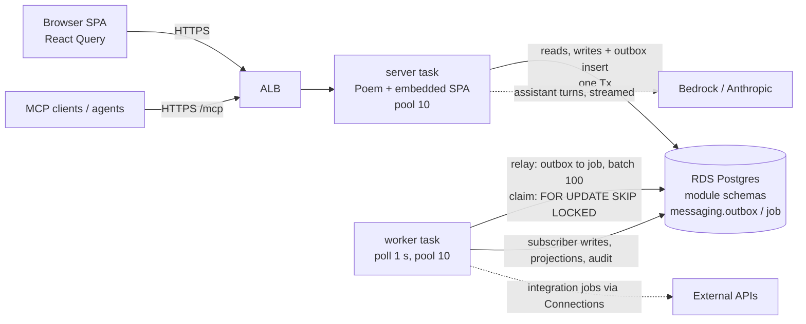
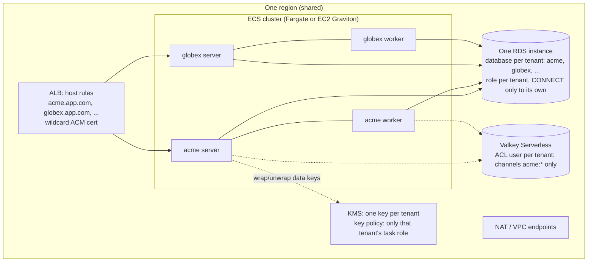

# Expected usage and AWS resource estimates

## Executive summary

> **Monthly total (USD, on-demand): US ~$140 · EU ~$150 · AU ~$180 lean. With HA: US ~$220 · EU ~$235 · AU ~$295.** The line-by-line breakdown is in the cost table below.
>
> **Pooled hosting (section 10):** with 20 tenants sharing one region's network, ALB, RDS, Valkey and KMS, but each keeping its own app, database, keys and secrets, the cost per tenant with HA is about **US ~$49 · EU ~$53 · AU ~$64** on ECS on EC2 Graviton (Fargate: ~$57 · ~$63 · ~$74). That's about 4× cheaper than standalone.
>
> **Neon instead of RDS (section 11):** this works if the server uses Neon's pooled URL and the worker and `migrate` use the direct URL. Standalone, the database drops to ~$39 a month on Launch (~$80 on Scale with an SLA) in any region. Pooled, with one Neon project holding a database per tenant, it comes to **~$25 to $30 per tenant** all in.

**What it is.** An internal suite of 6 business apps for one company of about 100 staff. It is a modular-monolith Rust server with an embedded React SPA and a Postgres-backed event outbox (the "kafka-lite" mechanism). It is single-tenant, busy during working hours and near idle overnight.

**Expected load.** Peak-hour traffic is about 7 to 36 API requests a second, bursting to about 110 at the generous design peak, with about 20% of requests writing. Each event fans out to about 1.5 subscriber jobs on average. Most topics have no consumer, and a few, like Users, have up to 8, but those change rarely. At the generous peak that comes to about 17 jobs a second, bursting to about 52. Subscriber deliveries are still the largest single share of database work, but at this fan-out the database runs at about 10% CPU in the peak hour, and every component runs at 25% or less of its capacity even in bursts.

**Resources (the same in every region):**

| Component | Size | Peak utilisation (generous case) |
|---|---|---|
| ECS Fargate `server` (API, SPA, MCP) | 1 task, 0.5 vCPU / 1 GB, ARM64 | ~25% CPU, under 10% memory |
| ECS Fargate `worker` (events, jobs) | 1 task, 0.25 vCPU / 0.5 GB, ARM64 | ~10% of one worker's throughput (~25% in bursts) |
| RDS PostgreSQL 17 | db.t4g.medium (2 vCPU / 4 GiB), 50 GB gp3 | ~10% CPU in the peak hour (~25% in bursts) |
| ALB + NAT gateway, logs, secrets | 1 each | — |
| Redis / Valkey | not needed yet | — |

**Monthly cost (USD, on-demand, 730 h):**

| | US (us-east-1) | EU (eu-west-1, Ireland) | AU (ap-southeast-2, Sydney) |
|---|---|---|---|
| Fargate `server` | $14 | $16 | $17 |
| Fargate `worker` | $7 | $8 | $9 |
| RDS db.t4g.medium, Single-AZ | $47 | $50 | $74 |
| gp3 storage 50 GB | $6 | $6 | $7 |
| ALB | $18 | $20 | $20 |
| NAT gateway (or public IPs + VPC endpoints) | $35 | $37 | $45 |
| CloudWatch, Secrets Manager, ECR | $10 | $10 | $10 |
| **Lean total** | **~$140** | **~$150** | **~$180** |
| **With HA** (2 servers, 2 workers, Multi-AZ RDS) | **~$220** | **~$235** | **~$295** |
| Later step-up to db.m7g.large (non-burstable), Single-AZ | +~$75 | +~$85 | +~$100 |

The Fargate ARM unit rates behind these figures: US $0.0324 per vCPU-hour and $0.0036 per GB-hour; Sydney $0.0389 and $0.0043; Ireland is estimated at about 20% below its x86 rate. RDS db.t4g.medium: about $47 a month in us-east-1, about $0.069 an hour in eu-west-1 and about $74 a month in Sydney. ALB, NAT and storage are approximate regional list prices. A 1-year Savings Plan or Reserved Instance takes about 20 to 35% off. Confirm the totals in the AWS Pricing Calculator.

**Recommendation.** Start lean on 1 server, 1 worker and a Single-AZ db.t4g.medium in the region closest to staff. Compute is under 20% of the bill, and the database and fixed network costs dominate. Move RDS to Multi-AZ when about 10 minutes of failover downtime becomes unacceptable. Scale the server out only after solving MCP session stickiness (7.3). Load-test staging before go-live (7.8).

---

For one company of about 100 people running 6 apps (Capabilities) on this template, deployed on ECS Fargate with RDS for PostgreSQL. Single-tenant: one environment, one database, one org. Prepared 2026-11-28 from the code at `main` plus a quick local benchmark.

**Short answer**

| Component | Start with | Grow to when |
|---|---|---|
| `server` (API, SPA, `/mcp`) | **1 task, 0.5 vCPU / 1 GB, ARM64** | 2+ tasks once MCP sessions don't need stickiness (see 7.3), or CPU > 60% |
| `worker` (outbox relay, subscribers, jobs, schedules) | **1 task, 0.25 vCPU / 0.5 GB, ARM64** | 2 tasks when job lag stays > 5 s at peak |
| `migrate` | one-off task per deploy, 0.25 vCPU / 0.5 GB | never |
| RDS PostgreSQL 17 | **db.t4g.medium (2 vCPU, 4 GiB), 50 GB gp3**, Single-AZ, PITR on | db.m7g.large when CPU credits trend down or CPU > 40% sustained, Multi-AZ when an outage of ~10 min costs more than about $75 a month |
| Valkey (ElastiCache) | **none**: no module broadcasts yet | the first module that calls `app_bus` |

At the generous design peak (about 110 API requests a second and 52 subscriber jobs a second in bursts), that comes to **about 0.75 vCPU and 1.5 GB of Fargate**, and the database runs at about 10% CPU during the peak hour. Cost is roughly **US$175 a month lean, about $290 with HA** in Sydney (section 8). The database and the fixed network costs dominate. Compute is almost nothing.

---

## 1. What the software is

- **Type.** Internal line-of-business software: a suite of apps (one App per Capability) in one SPA shell, used by staff during working hours. CRUD with optimistic concurrency, lists and searches, admin screens (access, connections, theme), an optional AI assistant, and every operation exposed as an MCP tool for agents.
- **Not multi-tenant.** One org, one rule set, about 100 principals. There are no noisy-neighbour or tenant-isolation costs, no per-tenant schemas, and the data set stays small (low GBs over years).
- **Load shape.** Read-heavy, bursty around 9 to 11 am and after lunch, near zero overnight. The traffic is human, not machine: requests per user are low, but each one fans out into several API calls.

## 2. Backend architecture as it affects sizing

The parts that matter for capacity:

| Fact (from the code) | Sizing consequence |
|---|---|
| One binary serves the API, the embedded SPA (1.2 MB JS bundle) and `/mcp` (ADR 0005). | One `server` service. Static assets are served from memory by the same tasks. |
| Modular monolith, one schema per module, one shared Postgres (ADR 0001, 0021). | One RDS instance. Modules don't add instances, only tables. |
| Each request: JWT verify (HS256 or cached JWKS), in-memory authorization (the rule set is rebuilt from the DB only when its revision moves, polled every 5 s, `access::POLL_EVERY`), then 1 to 3 SQL statements. | The server is cheap per request: about 0.35 ms CPU measured (section 4). There is no per-request authz query. |
| Every write saves one root and inserts one outbox row in the same transaction (ADR 0011, 0016). | One business write is about 2 to 4 row writes in the request path. |
| "Kafka-lite": the worker relays the outbox into `messaging.job` (one row per subscriber queue), then claims each job with `FOR UPDATE SKIP LOCKED`, runs the handler in its own transaction and deletes the job (ADR 0013, 0033). | Each write costs **1 + F** more transactions after the request, where F is the fan-out (the number of subscriptions on the topic). The Postgres work happens in the worker, not the request. |
| One relay at a time, by advisory lock, 100 events per batch (`RELAY_BATCH`). | Relay ceiling is in the thousands of events a second. Never the bottleneck here. |
| Each worker runs **one job at a time** (`while run_next()`), sequentially. | Worker throughput is about 1 / (job wall time), roughly 200 jobs a second per worker. Scale out by adding worker tasks. |
| The worker polls every 1 s when idle (`APP_WORKER_POLL_MS`). Delivery figures every 15 s. Compaction hourly. | A constant small DB load (about 1% of a core measured) and up to 1 s extra latency for the first event after an idle spell. |
| Outbox compaction keeps the latest event per key plus 7 days (topic retention). | The outbox stays small: MBs to low GBs. |
| `Idempotency-Key` on unsafe methods: a DB claim plus a record write. The SPA doesn't send one today; MCP tools can. | Applies only to agent writes. Negligible. |
| MCP sessions live in the memory of the process that opened them (ADR 0034). | **Several server tasks need stickiness by `Mcp-Session-Id`, which an ALB can't do** (section 7.3). |
| Assistant turns stream SSE from the server. Each tool call is an in-process call to `/api`. | Long-lived connections, very little CPU. The ALB idle timeout must be longer than a model call. |

Today's fan-out, from `messaging.subscription`: `users.user.v1` has 3 subscriptions, `notes.note.v1` 1, and each `access` topic 1 (the audit log). With 6 real apps, fan-out per topic is uneven:

- **Most topics: 0 consumers.** Their events are written to the outbox, marked dispatched by the relay and compacted. They cost one outbox row and no jobs.
- **Typical consumed topics: 1 to 2** (the owning app's own search projection, a reaction in one other app).
- **A few shared master-data topics: up to 8.** Users, for example, is projected by every app that shows or sorts by people.

What sizes the worker is F weighted by event volume, not by topic count. The high-fan-out topics are master data with ~100 keys that change a few times a day, so they barely move the average. The busy topics are each app's own transactional roots, which have 0 to 2 consumers. So **F = 1.5 jobs per event is realistic and F = 2 generous**. Even if every Users change hit 8 consumers, 100 users × a few changes a day is under 1,000 jobs a day.

## 3. Traffic model (Little's law)

Little's law for a closed system of users: **N = X · (R + Z)**, so **X = N / (R + Z)**. Here N is concurrent active users, X is throughput (interactions a second), R is response time and Z is think time between interactions. R (about 50 ms) is tiny next to Z, so X ≈ N / Z. Each interaction (a navigation, opening a dialog, saving a form) fans out into k API calls: React Query loads the page's list and its lookups, a mutation is followed by an invalidation refetch, and with the default `staleTime: 0` every window focus refetches the active queries.

| Input | Realistic (R) | Generous design (G) | Why |
|---|---|---|---|
| Headcount | 100 | 100 | given |
| Daily active users | 85 | 100 | almost everyone uses at least one of 6 apps |
| Active time in the apps per user per day | 3 h | 5 h | internal tools beside email, meetings and other systems |
| Peak concurrent active users, N | 50 (60% of DAU) | 100 (everyone at once) | the 9 to 11 am peak |
| Think time between interactions, Z | 20 s | 10 s | reading a list, filling a form |
| API calls per interaction, k | 2.5 | 3 | list + lookups + enrichment, or mutation + refetch |
| Background calls (focus refetch, permissions and theme at a 60 s stale time) | +20% | +20% | `refetchOnWindowFocus`, `use-my-permissions`, `theme-loader` |
| Share of API calls that write | 15% | 20% | typical for LOB software: 80 to 90% reads |
| Second-to-second burst over the peak-hour mean | ×3 | ×3 | people act in clumps |

### 3.1 API requests

Peak-hour mean: X_api = N · k / Z · 1.2

- R: 50 × 2.5 / 20 × 1.2 = **7.5 req/s**, bursting to **~23 req/s**
- G: 100 × 3 / 10 × 1.2 = **36 req/s**, bursting to **~110 req/s**

Daily volume: DAU × active seconds / Z × k × 1.2

- R: 85 × 10,800 / 20 × 2.5 × 1.2 ≈ **140k API requests a day** (~4.8 req/s over an 8 h day)
- G: 100 × 18,000 / 10 × 3 × 1.2 ≈ **650k API requests a day** (~22 req/s over an 8 h day)

Add about 10 full page loads per user a day (`index.html`, the 1.2 MB bundle, fonts), about 10k static requests a day, and agent and MCP traffic. Say 30 assistant users doing 20 turns a day with about 5 tool calls each: about 3k tool calls a day, which is also API requests. Both are noise next to the above.

**Concurrency inside the server** (Little's law again, L = λ·W): at the G burst, 110 req/s × ~15 ms on Fargate (DB round trips included) ≈ **1.7 requests in flight**. Connections held: 110 × ~4 ms ≈ **0.5 of the 10-connection pool**. Streaming assistant turns: λ ≈ 600 turns over 8 h ≈ 0.02/s, × ~30 s per turn ≈ **1 open stream** on average, 5 to 10 at a busy moment.

### 3.2 Writes, events and fan-out (the kafka-lite load)

events = writes × c, where c covers cascades: a subscriber's write publishes its own event, as a projection or reaction may. jobs = events × F, plus deferred jobs and Schedules, which are negligible.

| | R (F = 1.5, c = 1.1) | G (F = 2, c = 1.2) |
|---|---|---|
| Writes / day | 21k | 130k |
| Events / day | 23k | 156k |
| Subscriber jobs / day | 35k | ~310k |
| Writes / s, peak-hour mean (burst) | 1.1 (3.5) | 7.2 (22) |
| Events / s, peak-hour mean (burst) | 1.2 (3.8) | 8.6 (26) |
| **Jobs / s, peak-hour mean (burst)** | **2 (6)** | **17 (52)** |

Each business write costs Postgres roughly this:

- request: the root row (+ child rows) and 1 outbox insert, in 1 transaction
- relay: 1 outbox update and F job inserts, shared across a batch of up to 100
- each of F deliveries: claim (update), handler writes (1 to 3 rows), job delete, in 1 transaction each

So **about 3 + 3F row operations and 1 + F commits per write**: about 7.5 row ops and 2.5 commits at F = 1.5, about 9 and 3 at F = 2. Deliveries are still the largest single share of database CPU (section 4.3), but at this fan-out they are about the same order as the HTTP traffic, not a multiple of it.

**Worker sizing by Little's law.** Measured locally, one worker drained 3,000 jobs in 11.5 s, about 260 jobs/s, as a debug build with Postgres on the same host. On Fargate to RDS, each job is about 6 round trips (claim, begin, handler, delete, commit) at about 0.5 to 0.8 ms each, so about 5 ms of wall time, or **~200 jobs/s per worker**. Utilisation ρ = λ × 5 ms:

- R: 2 jobs/s gives ρ ≈ 1%. Bursts of 6/s are 3%.
- G: 17 jobs/s gives ρ ≈ 9%. Bursts of 52/s are 26%. One worker has about 4× headroom over the generous burst. A second worker is only for redundancy. Even a burst above capacity just queues in the outbox and job tables and drains seconds later.

## 4. Measurements behind the per-unit costs

Measured on the dev stack with ApacheBench (`ab -c 10`): the release `server` binary on an Apple M5 Pro, Postgres 17 in Docker, the debug `worker`, and the seeded data set. These are **per-unit CPU costs** to scale from, not capacity claims. Graviton cores on Fargate and RDS are slower per core than an M5, so I apply a **×2 to ×3 factor** to every figure.

| Measure | Local, measured | Estimate on Fargate / RDS Graviton |
|---|---|---|
| Server CPU per list request (`GET /api/notes?limit=20`, JWT + authz + 2 queries + JSON) | 0.35 ms (10k requests, 3.53 s CPU) | **~1 ms** |
| Server CPU per write (`POST /api/notes`) | 0.40 ms (2k requests, 0.81 s CPU) | **~1.2 ms** |
| Throughput, one process, 10 concurrent | 3,100 list/s, 4,500 get/s, 2,300 create/s, p99 5 to 9 ms | not the limit at this scale |
| Postgres CPU per read | 0.24 to 0.6 ms | **~1 ms** |
| Postgres CPU per write (row + outbox) | 0.47 to 0.66 ms | **~1.3 ms** |
| Postgres CPU per delivered job (relay + claim + projection upsert + delete) | ~2.8 ms (with a 2,000-job backlog, so an upper bound) | **~5.5 ms** |
| Postgres CPU when idle (1 server + 1 worker polling) | ~12 ms/s (1.2% of a core) | ~50 ms/s for 2 servers + 2 workers |
| Server RSS (release) | 27 MB at start, 33 MB after 30k requests | ~40 to 60 MB |
| Worker RSS | ~25 MB | ~30 to 50 MB |
| Job drain, one worker | ~260 jobs/s (debug build, local DB) | **~200 jobs/s** (network RTT bound) |

The load-test rows were deleted from the dev database afterwards.

### 4.1 Server vCPU

- R burst: 23 req/s × 1 ms ≈ 0.02 vCPU
- G burst: 110 req/s × 1 ms ≈ **0.11 vCPU**

A 0.5 vCPU task serves about 400 req/s at 80% CPU, **nearly 4× the generous burst**. I'd still pick 0.5 rather than 0.25 vCPU: startup (JWKS discovery, compiling the rule set), the 5 s rule-set rebuild after a grant changes, and assistant turns all spike CPU briefly, and 0.25 vCPU CFS-throttles those spikes into visible latency. The extra cost is about $9 a month.

### 4.2 Server and worker memory

Measured RSS is under 60 MB, all in. In-memory state is tiny: the compiled rule set (100 principals), MCP sessions (5 min idle), assistant turns in flight. **1 GB per server task and 0.5 GB per worker** leaves more than 90% headroom. Memory is not a constraint for this app at this scale.

### 4.3 Database CPU

Postgres vCPU-seconds per second = reads × 1 ms + writes × 1.3 ms + jobs × 5.5 ms + idle 0.05

| | Reads | Writes | Jobs | Idle | Total | % of 2 vCPU |
|---|---|---|---|---|---|---|
| R peak-hour mean | 6.4/s → 0.006 | 1.1/s → 0.001 | 2/s → 0.011 | 0.05 | **0.07 vCPU** | 3.5% |
| G peak-hour mean | 29/s → 0.029 | 7.2/s → 0.009 | 17/s → 0.094 | 0.05 | **0.18 vCPU** | 9% |
| G burst (seconds) | 88/s → 0.09 | 22/s → 0.03 | 52/s → 0.29 | 0.05 | **~0.46 vCPU** | 23% |

In G, subscriber deliveries are about 70% of the database's non-idle CPU, but the total is small. A db.t4g.medium has a baseline of 20% per vCPU (0.4 vCPU sustained) and earns 24 CPU credits an hour, banking up to 576. So:

- **R** runs at about a sixth of the baseline. The instance banks credits all day.
- **G** runs at under half the baseline in the peak hour and only briefly exceeds it in bursts. Credits never drain on a working-hours profile, and even all-day G load would stay under the baseline. The move to **db.m7g.large** (non-burstable) is now a trigger for growth, not something this load needs.
- **db.t4g.small (2 vCPU / 2 GiB)** would also carry this CPU (same 0.4 vCPU baseline), saving about $23 a month in the US and EU and about $37 in AU. I still recommend the medium: 4 GiB keeps the whole data set and connections in memory with room to spare, and the extra cost is small.

### 4.4 Database memory, storage, IOPS and connections

- **Data.** 6 apps × 100 users of business records: a few hundred MB in year one, low single-digit GB after a few years (more if apps store documents in Postgres, which they shouldn't: use S3). The outbox holds the latest event per key plus 7 days: ~0.25 GB (R) to ~1.6 GB (G) of churn at about 1.5 KB an event, since events carry the root's whole state. The access audit log grows forever but slowly. Jobs are deleted when they complete. Idempotency records live 24 h.
- **RAM.** With 4 GiB, `shared_buffers` (~1 GiB) holds the whole hot set for years. Move to 8 GiB (db.t4g.large or db.m7g.large) if the buffer cache hit ratio drops below ~99%.
- **Storage.** **50 GB gp3** (3,000 IOPS and 125 MB/s baseline included). G bursts are about 200 commits/s and about 400 row ops/s, well under the baseline IOPS. Turn on storage autoscaling with a 200 GB ceiling.
- **Connections.** Each process has a pool of 10 (`APP_DB_MAX_CONNECTIONS`): 1 to 2 servers + 1 to 2 workers + `migrate` gives at most 50, against the ~400 a db.t4g.medium defaults to. Little's law says fewer than 2 are busy at a time. No RDS Proxy needed.

## 5. Recommended Fargate topology (initial)

| ECS service / task | Count | Size (ARM64 / Graviton) | Notes |
|---|---|---|---|
| `server` | 1 | 0.5 vCPU / 1 GB | Rolling deploy with `minimumHealthyPercent=100`, `maximumPercent=200`, so a deploy never drops to zero. Health check `/health`. ECS replaces a failed task in about a minute. One task keeps MCP sessions working (7.3). |
| `worker` | 1 | 0.25 vCPU / 0.5 GB | Long-running poll mode. Its idempotent handlers and 5-minute lease make Fargate Spot safe (saves ~$5 a month). An interruption delays jobs in flight by up to the lease. On-demand is simpler. |
| `migrate` | one-off | 0.25 vCPU / 0.5 GB | Run as a pre-deploy task (`/usr/local/bin/migrate`) before the server and worker update. |
| ALB | 1 | — | HTTPS listener (ACM). **Idle timeout ≥ 300 s** for assistant SSE streams. Pass streams unbuffered. |
| RDS PostgreSQL 17 | 1 | db.t4g.medium, 50 GB gp3 | Single-AZ, 7-day PITR. Private subnets. Performance Insights (free tier) to check section 4's estimates. |
| Secrets | — | Secrets Manager / SSM | `DATABASE_URL`, `CONNECTIONS_MASTER_KEY`, model credentials. |
| Valkey | 0 | — | Not needed until a module broadcasts (ADR 0039). The server and worker refuse to start without it once one does. |

Everything is in 2 AZs, with private subnets for tasks and RDS. For egress (JWKS, Cognito, Bedrock or Anthropic, integration APIs), either one NAT gateway, or public subnets with public IPs plus VPC endpoints for ECR, Logs and Secrets Manager.

## 6. Scaling headroom and triggers

| Signal (CloudWatch / OTLP) | Threshold | Action |
|---|---|---|
| Server CPU | > 60% for 10 min | add a task, or 1 vCPU / 2 GB (sort out MCP first, 7.3) |
| Request p95 (`http.server.request.duration`) | > 300 ms | look at the DB first: slow queries, missing index |
| Job lag / dead letters (the worker's delivery figures) | lag > 5 s sustained at peak, or any dead letters | add a worker task / fix the handler |
| Pool waits (`app_web::PoolWaits`) | p95 > 10 ms | raise `APP_DB_MAX_CONNECTIONS` to 20 |
| RDS `CPUCreditBalance` | trending down day over day | db.m7g.large |
| RDS CPU | > 40% for an hour | db.m7g.large (later db.m7g.xlarge) |
| RDS buffer cache hit | < 99% | an 8 GiB class |
| RDS `FreeStorageSpace` | < 20% | storage autoscaling handles it |

**Headroom.** The recommended setup handles about 4× the generous burst on both the server and the worker. The database is at about 9% of a burstable 2-vCPU at the G peak hour (23% in bursts). A 500-person single-tenant deployment would still fit on 2 servers, 2 workers and one db.m7g.large.

## 7. Risks and cheap tuning found while reviewing

1. **The SPA's assets go out with no `Cache-Control`, no `ETag` and no compression** (`crates/server/src/app.rs`, `frontend::Spa`). Every full load downloads the 1.2 MB bundle again, uncompressed (~350 KB gzipped). It costs little money (~25 GB a month of egress, ~$3), but every cold load is slower. Fix: `Cache-Control: public, max-age=31536000, immutable` on `/assets/*` (the names are content-hashed), `no-cache` on `index.html`, and poem's `Compression` middleware. Or put CloudFront in front.
2. **React Query's default `staleTime: 0` with refetch on focus** is the biggest read multiplier. A global `staleTime` of 15 to 30 s would cut reads by about 30 to 50% with no visible staleness for LOB screens, since `If-Match` already protects writes.
3. **MCP sessions need stickiness by header, which an ALB can't do** (its stickiness is cookie-based, and MCP clients generally don't keep cookies). With 2+ server tasks behind round-robin, session requests land on the wrong task, get a `404`, and the client starts a new session again and again. Options: (a) **1 server task** (recommended initially, with ample capacity), (b) an ALB rule sending `/mcp*` to a separate single-task service from the same image, or (c) make `/mcp` stateless as Spec 0010 proposes. Decide this before scaling the server out.
4. **Worker jobs run one at a time per worker**, and a handler holds its transaction (and a connection) open while it runs (ADR 0011). An integration job calling a slow external API blocks that worker's other queues for the call's duration. If integrations become busy, give them their own worker deployment (the queues are named) or add workers.
5. **The claim query's cost grows with the number of subscriptions a worker serves**: it does a `LATERAL` index probe per (queue, event_type), plus the per-key ordering and backfill `NOT EXISTS` checks. That is fine at dozens of subscriptions. Watch it in Performance Insights as the apps grow to 50+ subscriptions.
6. **t4g credit trap.** Burstable RDS runs in Unlimited mode. If the load turns out to be sustained rather than working-hours bursty, surplus credits are billed. Watch `CPUSurplusCreditsCharged`.
7. **Assistant cost is tokens, not compute.** Each model call carries the tool list (one tool per operation: 49 today, more with 6 apps) and up to 50 history messages, so the tool schemas alone are many thousands of input tokens per call, with up to 10 tool calls a turn. Budget it separately (Bedrock or Anthropic), and consider prompt caching or a narrower tool set.
8. **Calibrate with a real load test.** These are model numbers scaled from a laptop. Before go-live, run a k6 scenario on staging (the same Fargate and RDS sizes) at the G mix: 110 req/s, 20% writes, F = 2 (with the Users topic at 8). Confirm p95 < 200 ms, job lag < 5 s and RDS CPU < 50%.

## 8. Indicative monthly cost (ap-southeast-2, on-demand, USD)

Approximate list prices: Fargate ARM about $0.0389 per vCPU-hour and $0.0043 per GB-hour in Sydney. db.t4g.medium PostgreSQL in Sydney is about $74 a month Single-AZ. 730 h a month. Check the AWS Pricing Calculator before committing.

| Item | Lean start | With HA |
|---|---|---|
| `server` Fargate (0.5 vCPU / 1 GB) | 1 × ~$17 | 2 × ~$17 = $35 (once 7.3 is solved) |
| `worker` Fargate (0.25 vCPU / 0.5 GB) | ~$9 | 2 × ~$9 = $17 |
| RDS db.t4g.medium | ~$74 (Single-AZ) | ~$148 (Multi-AZ) |
| gp3 50 GB + backups within the free allowance | ~$7 | ~$14 |
| ALB (+ LCUs, negligible here) | ~$20 | ~$20 |
| NAT gateway, or public IPv4 + VPC endpoints | ~$35 to 45 | ~$35 to 45 |
| CloudWatch logs and metrics, Secrets Manager, ECR | ~$10 | ~$15 |
| **Total** | **~$175 to 185** | **~$285 to 295** |

A 1-year Compute Savings Plan (Fargate) and an RDS Reserved Instance cut about 20 to 30% off the larger lines. The jump to db.m7g.large adds about $90 to 100 a month Single-AZ.

## 9. Assumptions to revisit

- 6 apps of LOB-style CRUD, with no app doing heavy reporting or analytics in Postgres. A reporting app scanning big tables changes the RDS sizing more than everything above. Give it a read replica or its own projection.
- No bulk imports or integration syncs moving thousands of rows a minute. A nightly sync of 50k records fans out to 50k × F jobs: at 200 jobs/s per worker that is ~6 minutes for F = 1.5, which is fine overnight. A bulk sync into a master-data topic with 8 consumers (say, importing 5k users) is 40k jobs, about 3.5 minutes.
- Agents over MCP behave like a few extra humans, not loops of hundreds of calls a minute. If agents are automated, apply Little's law to them separately: N_agents × calls a minute.
- Browser-to-ALB latency (Sydney) is not counted in R. It doesn't change throughput, since R ≪ Z.

## 10. Pooled multi-tenant hosting (many single-tenant deployments, shared infrastructure)

The app stays single-tenant: each customer gets its own `server` and `worker`, its own database, its own Cognito pool and its own secrets, all from the same image. What's pooled is everything underneath, once per region. This keeps the code and its guarantees unchanged and gets most of the cost benefit of SaaS.

### 10.1 What's shared and what isn't

| Shared per region | Kept per tenant |
|---|---|
| VPC, subnets, NAT gateways, VPC endpoints | ECS services (`server`, `worker`) and their task IAM role |
| ALB (one host rule + target group per tenant; 100 rules per listener by default, raisable) | Database and DB role on the shared RDS |
| ECS cluster, capacity (Fargate or EC2), ECR image | Cognito user pool / OIDC client (`APP_JWT_ISSUER`, `APP_OIDC_CLIENT_ID`) |
| RDS instance | KMS key, Secrets Manager secrets |
| Valkey Serverless cache | Valkey ACL user and channel prefix |
| Observability stack (tenant as a resource attribute) | Log group (or a `tenant` field), alarms |

**Databases.** A schema per tenant won't work, because every module already owns a schema in its database (`notes`, `access`, `messaging`, ...). A database per tenant fits cleanly: each tenant's `DATABASE_URL` names its own database, its own `migrate` runs against it, and its outbox, jobs, idempotency records and advisory locks (`RELAY_LOCK` is scoped to the database) are isolated. Run `REVOKE CONNECT ON DATABASE ... FROM PUBLIC` on every database and give each tenant's role `CONNECT` on its own only.

**Tune each tenant for sharing:** `APP_WORKER_POLL_MS=3000` (the idle poll is the main cost that scales with tenant count: ~25 ms of DB CPU a second per tenant at 1 s, ~8 ms at 3 s; the cost is up to 3 s more event latency) and `APP_DB_MAX_CONNECTIONS=5` per process (10 per tenant, so 200 connections for 20 tenants, well inside a 16 GiB instance's ~1,600).

### 10.2 Sizing the shared database

Tenants in one region share business hours, so assume their peaks coincide (no statistical smoothing). Per tenant at peak, with a 3 s poll: **~0.04 vCPU realistic, ~0.14 vCPU generous** (section 4.3 minus most of the idle cost).

| Instance | vCPU / RAM | Tenants (realistic) | Tenants (all generous) |
|---|---|---|---|
| db.m7g.large | 2 / 8 GiB | ~15 to 20 | ~8 |
| db.m7g.xlarge | 4 / 16 GiB | ~30 to 40 | ~15 to 20 |
| db.m7g.2xlarge | 8 / 32 GiB | ~60 to 80 | ~35 |

Keep peak CPU under ~60%. Use the non-burstable m7g class: 20 tenants peaking together would drain a t4g's credits by mid-morning. RAM is rarely the limit at a few GB per tenant, but check the buffer cache hit ratio as tenants grow. Move a heavy tenant out with a dump/restore or logical replication of its one database.

**Risks of sharing the database:** maintenance windows, version upgrades and failovers hit every tenant at once. One tenant's bulk import or heavy report can slow the others, so watch per-database load in Performance Insights. Point-in-time recovery restores the whole instance, so restoring one tenant means restoring to a new instance and then dumping and restoring that one database. Script and test this before you need it.

### 10.3 Compute: Fargate vs ECS on EC2 Graviton

On Fargate, each tenant pays for its minimum task sizes (0.5 + 0.25 vCPU) while using about 0.1 vCPU and 100 MB. ECS on EC2 lets tasks share instances and reserve what they actually use:

| Task (EC2 launch type) | CPU units reserved (soft share) | Memory reservation (soft) / limit (hard) |
|---|---|---|
| `server` | 128 (0.125 vCPU) | 128 MB / 512 MB |
| `worker` | 64 (0.0625 vCPU) | 64 MB / 256 MB |
| **Per tenant** | **192 units** | **192 MB / 768 MB** |

CPU shares are soft, so an idle tenant's CPU goes to a busy one. Memory reservations pack tasks, and hard limits contain a runaway task.

- **One m7g.xlarge (4 vCPU / 16 GiB) fits ~20 tenants:** 20 × 192 = 3,840 of its 4,096 CPU units, and 20 × 768 MB = 15 GB of hard limits. Generous-peak CPU use is ~20 × 0.15 ≈ 3 vCPU, so one host is the safe maximum. Run **2 hosts in 2 AZs, each able to take every tenant** (N+1), so they normally run at ~50%.
- **Networking:** the `awsvpc` mode gives each task an ENI, and an m7g.xlarge has only 4 ENIs. Turn on **ENI trunking** (`awsvpcTrunking`) or use `bridge` mode with dynamic host ports and instance-type target groups.
- **Operations you take on:** an Auto Scaling group with a capacity provider, AMI patching (use Bottlerocket or the ECS-optimised AL2023 with managed instance draining), and spreading each tenant's server across AZs.
- **A middle path:** keep `server` on Fargate, where it's user-facing and you avoid patching, and pack workers onto EC2 or run them on Fargate Spot.

### 10.4 Shared Valkey with tenant isolation

Nothing broadcasts yet, but this is cheap to get right before anything does. Pub/sub ignores the Redis DB index, and `RedisBus` publishes on plain channel names (`crates/common/bus/src/redis.rs`), so two tenants on one cache would hear each other today. Two layers fix that:

1. **Prefix (code change, small):** an `APP_BUS_PREFIX` setting (say, `acme:`) that `RedisBus` prepends to every channel on `PUBLISH` and `SUBSCRIBE`. Nothing above the `Bus` trait changes.
2. **Enforced by Valkey ACLs:** ElastiCache Serverless for Valkey supports RBAC users. Give each tenant a user whose access string allows only its channels and the pub/sub commands, roughly `on ~nothing resetchannels &acme:* -@all +publish +subscribe +ping +hello +auth`. A bug in the prefix then fails closed, as a `NOPERM`, rather than leaking. Each tenant's `APP_REDIS_URL` carries its own username and password.

TLS is on by default for ElastiCache Serverless. Cost: one cache's minimum, about $6 a month plus a few dollars of ECPUs for the whole region, instead of $6 or more per tenant.

### 10.5 KMS as a tenant security layer

KMS doesn't isolate compute or the database engine, but it makes each tenant's secrets cryptographically separate and lets you **crypto-shred** a tenant on offboarding. Create one customer-managed key per tenant (alias `alias/tenant/acme`), with a key policy that allows `kms:Encrypt`/`Decrypt`/`GenerateDataKey` only to that tenant's task role, plus an `EncryptionContext` condition `tenant = acme`. A compromised task of another tenant, or a misconfigured env var pointing at the wrong key, then gets `AccessDenied`.

| Where | How | Effort |
|---|---|---|
| **Connections' secrets** (ADR 0050) | A `KmsKeyProvider` adapter behind the existing `KeyProvider` port: `GenerateDataKey`/`Decrypt` with the tenant's key, envelope format unchanged. ADR 0050 already names it as the next adapter. It replaces the `CONNECTIONS_MASTER_KEY` env var, so no raw master key lives in a task definition. Cache unwrapped data keys in memory briefly to keep KMS calls rare. | Small: one adapter + config |
| **Secrets Manager** (`DATABASE_URL`, Valkey password, model keys) | Encrypt each tenant's secrets with its key. Only its task execution role can read them. | Config only |
| **S3** (attachments, exports, if apps add them) | A bucket or prefix per tenant with SSE-KMS under its key and a bucket policy matching the role. | Config only |
| **Bus payloads** (optional) | Encrypt payloads with a tenant data key before `PUBLISH`. This is defence in depth over the ACLs, and probably unnecessary. | Small |
| **RDS** | Storage encryption is **one key per instance**, not per database, so all tenants on an instance share it. For per-tenant cryptographic separation of especially sensitive columns, encrypt them in the application with a tenant data key (the same envelope as Connections). Otherwise a dedicated instance is the only per-tenant key. | Per-column app work, or a dedicated instance |

**Cost:** $1 per key per month plus $0.03 per 10,000 requests: about $20 to $25 a month for 20 tenants with data-key caching.

**Offboarding:** schedule the tenant's key for deletion (7 to 30 day wait). Its Connections secrets, Secrets Manager values and S3 objects become unreadable everywhere, backups included. Drop its database, and age the instance's snapshots out.

### 10.6 Cost: 20 tenants per region, with HA, on-demand USD a month

Assumptions: 2 hosts or tasks per tenant across 2 AZs where noted, a Multi-AZ RDS db.m7g.xlarge with 200 GB gp3, 2 NAT gateways, 1 ALB, Valkey Serverless, 20 KMS keys, ~3 secrets per tenant. EC2 m7g.xlarge on-demand: US $0.1632/h, EU (Ireland) $0.1819/h, AU (Sydney) $0.204/h. db.m7g.xlarge: US $0.337/h, with EU and AU estimated at about +11% and +40%. Confirm in the AWS Pricing Calculator.

| Item | US (us-east-1) | EU (eu-west-1) | AU (ap-southeast-2) |
|---|---|---|---|
| Compute, **ECS on EC2**: 2 × m7g.xlarge + EBS | $250 | $275 | $310 |
| Compute, *Fargate instead*: 20 × (server + worker) | *$420* | *$480* | *$520* |
| RDS db.m7g.xlarge Multi-AZ | $492 | $545 | $690 |
| RDS gp3 200 GB Multi-AZ | $46 | $50 | $55 |
| ALB (+ LCUs) | $30 | $32 | $35 |
| NAT gateways × 2 (+ data) | $70 | $75 | $90 |
| Valkey Serverless (shared) | $10 | $10 | $12 |
| KMS (20 keys) | $22 | $22 | $22 |
| Secrets Manager, CloudWatch, ECR | $50 | $50 | $55 |
| **Total, ECS on EC2** | **~$970** | **~$1,060** | **~$1,270** |
| **Per tenant, ECS on EC2** | **~$49** | **~$53** | **~$64** |
| *Total / per tenant, Fargate* | *~$1,140 / $57* | *~$1,265 / $63* | *~$1,480 / $74* |
| *Standalone, per tenant (exec summary, with HA)* | *~$220* | *~$235* | *~$295* |

- **Pooling is about 4 to 4.5× cheaper per tenant** than standalone HA deployments. ECS on EC2 saves another ~15% over Fargate at 20 tenants, more as hosts fill.
- **RDS is now about half the bill.** A Single-AZ shared instance would halve that line (per tenant ~$37 US, ~$40 EU, ~$46 AU on EC2). That's a reasonable trade for a non-critical tier, but a failover then hits 20 customers at once.
- **Savings Plans and reserved instances** (1 year) take ~30% off EC2 and RDS: **~$35 US, ~$38 EU, ~$45 AU per tenant**.
- **Marginal cost** once the region exists: about one tenant's compute share plus 1/20 of the database, roughly **$25 to $35 a month per extra tenant** until the next database or host step.

### 10.7 Things to do before pooling

1. Add `APP_BUS_PREFIX` to `RedisBus`, and document the per-tenant ACL user in the `run-and-deploy` skill.
2. Add the `KmsKeyProvider` adapter to `connections` (ADR 0050's planned follow-up), with config selecting env or KMS.
3. Write an ADR recording pooled regional infrastructure. It replaces Spec 0010's account-per-environment proposal with one account per region, isolating tenants by database role, IAM task role, KMS key policy and Valkey ACL.
4. Script tenant onboarding (database + role, secrets, KMS key, Valkey user, Cognito pool, ECS services, ALB rule) and offboarding (key deletion, database drop). Include a single-tenant restore runbook (10.2).
5. Load-test 20 tenants concurrently against one db.m7g.xlarge at the realistic mix to confirm the tenants-per-instance figures.

## 11. Neon instead of RDS

### 11.1 Compatibility: pooled for the server, direct for the worker and `migrate`

Neon's pooled endpoint (`-pooler` host) is PgBouncer in **transaction mode**. Session state doesn't survive a commit there: `SET`, `LISTEN`, SQL-level `PREPARE`, temp tables and **session** advisory locks all fail. Protocol-level prepared statements work, because Neon sets `max_prepared_statements=1000`. Checked against the code:

| Feature (where) | Scope | Pooled OK? |
|---|---|---|
| sqlx's statement cache (every `query!`) | protocol-level prepared statements | **Yes** |
| Relay lock `pg_try_advisory_xact_lock` (`worker.rs`), backfill `pg_advisory_xact_lock` (`subscriptions.rs`), retire function (migrations 0008, 0009) | transaction | **Yes** |
| `FOR UPDATE SKIP LOCKED` claim, units of work, `If-Match` version guards | transaction | **Yes** |
| Delivery figures `pg_try_advisory_lock` + `conn.detach()` (`figures.rs`, worker only) | **session** | **No**: the lock would stay on a pooled backend another client then gets |
| `SET search_path` per module (`run_migrations`, `migrate` only) | **session** | **No** |
| Server request path (handlers, authz rule-set refresh, idempotency records, MCP) | no session state | **Yes** |

So, exactly as you suggested:

- **`server` → pooled URL** (`ep-xxx-pooler.<region>.aws.neon.tech`). Keep sqlx's own pool small (`APP_DB_MAX_CONNECTIONS=5`), since PgBouncer does the multiplexing.
- **`worker` → direct URL.** The figures' session lock is the only blocker. Everything else in the kafka-lite path is transaction-scoped. Long relay and claim transactions are better on a direct connection anyway.
- **`migrate` → direct URL** (search_path, DDL, sqlx's migration lock).

This needs `DATABASE_URL` to differ per binary, which is already the case since each is its own ECS task.

### 11.2 The catch: the worker keeps Neon awake

Neon scales compute to zero after 5 idle minutes, but the worker polls every second, so **the compute never suspends**. You pay for it all month, autoscaling between a minimum and maximum CU (1 CU ≈ 1 vCPU / 4 GB). Options:

- **Accept it** (simplest). Autoscale 0.25 to 1 CU: about 1 CU through 10 business hours × 22 days and 0.25 CU otherwise, so ≈ 220 + 130 = **~350 CU-hours a month**.
- **Let it sleep overnight.** Stop the polling worker out of hours (an ECS scheduled scale to 0), and run `worker --drain` from EventBridge every 15 to 30 minutes, so events wait up to that long at night. The 5-minute suspend then applies between runs, bringing it to about 250 CU-hours. Worth it mainly for idle tenants (11.4).
- Don't lower `APP_WORKER_POLL_MS` to make it sleep: any poll under 5 minutes keeps it awake.

### 11.3 Single-tenant cost: Neon vs RDS (USD a month)

Neon Launch is $0.106/CU-hour, Neon Scale $0.222/CU-hour (99.95% SLA), storage $0.35/GB-month, the same rate in every region. Neon has **no Ireland region**: in the EU use Frankfurt (eu-central-1) or London (eu-west-2), and run the ECS side in the same region (Fargate there costs about the same as Ireland).

| | US | EU (Frankfurt) | AU (Sydney) |
|---|---|---|---|
| RDS db.t4g.medium Single-AZ + 50 GB (section 8 / exec summary) | $53 | $56 | $81 |
| **Neon Launch**, ~350 CU-h + 5 GB | **~$39** | **~$39** | **~$39** |
| RDS db.t4g.medium Multi-AZ + 50 GB | $106 | $112 | $162 |
| **Neon Scale** (SLA), ~350 CU-h + 5 GB | **~$80** | **~$80** | **~$80** |

- **Neon is cheaper for one tenant everywhere, most of all in Sydney**, because Neon prices are flat across regions and AWS's Sydney premium doesn't apply.
- **Network:** Neon sits outside your VPC, reached over TLS through your NAT gateway (data volume here is a few GB, ~$0.05/GB). PrivateLink is available on higher plans. It's an extra hop: Neon in the same AWS region adds about 1 ms per round trip over in-VPC RDS. The request path barely notices. The worker's ~6 round trips per job take it from ~200 to ~100 jobs/s, still ~2× the generous burst (section 3.2).
- **What you gain:** branching (a copy of production for a migration rehearsal in seconds), point-in-time restore **per project**, and no instance sizing or credit balance to watch.
- **What you lose:** a VPC-private database by default, RDS's IAM auth and AWS-native backups and KMS keys, and one bill. Neon's HA model (storage replicated, compute restarted on failure) isn't the same as Multi-AZ failover: check the SLA plan fits.

### 11.4 Neon for pooled multi-tenant hosting (section 10)

Here Neon changes the shape, not just the price. Two ways to use it:

**A. A Neon project per tenant.** Launch allows 100 projects, Scale 1,000.
- Strongest isolation: separate compute, storage, credentials and PITR per tenant. It **solves the single-tenant restore problem** in 10.2, and offboarding is deleting the project.
- But nothing is shared: each tenant pays its own ~350 CU-hours, or ~250 with overnight drain. At 20 tenants: **~$780 a month on Launch, ~$1,600 on Scale**, against ~$540 for a shared Multi-AZ db.m7g.xlarge in the US (more in AU).
- It's cheapest when tenants are small or idle a lot, since each scales to its 0.25 CU floor or to zero.

**B. One Neon project, a database per tenant** (the same layout as 10.1).
- Shared compute autoscales to the regional peak, say 0.5 CU overnight and 3 to 4 CU in business hours: about 22 × 10 × 3.5 + 510 × 0.5 ≈ 1,025 CU-hours, so **~$110 a month on Launch or ~$230 on Scale for 20 tenants**, plus storage (~$35 for 100 GB). That is the cheapest database option in this report.
- Same trade-offs as a shared RDS: shared fate, noisy neighbours, and restoring one tenant means branching the project and copying that one database out.
- Watch connections: pooled server connections are cheap, but each tenant's direct worker connections count against the compute's `max_connections`, about 419 at 1 CU and more at larger sizes. At 5 per worker, 20 tenants need 100.

**Pooled cost per tenant, 20 tenants, ECS on EC2, with HA (compare 10.6):**

| Database option | US | EU (Frankfurt) | AU |
|---|---|---|---|
| Shared RDS db.m7g.xlarge Multi-AZ (10.6) | ~$49 | ~$53 | ~$64 |
| **B. Neon Scale, one project, database per tenant** | **~$25** | **~$28** | **~$30** |
| A. Neon Launch, project per tenant | ~$62 | ~$65 | ~$68 |
| A. Neon Scale, project per tenant | ~$105 | ~$108 | ~$112 |

Rows B and A swap the RDS lines of 10.6 for Neon compute and storage, and keep everything else (EC2, ALB, NAT, Valkey, KMS, secrets). The EU figures assume Frankfurt EC2 at about Ireland's rates.

**A hybrid:** run option B for the general pool, and give large, regulated or noisy tenants their own Neon project (option A), or their own RDS. Moving a tenant between them is a dump/restore, or logical replication, of its one database.

### 11.5 What to change in the code and docs for Neon

1. **Optional:** make the figures reader's lock transaction-scoped (`pg_try_advisory_xact_lock` held for the read), so the worker can use the pooled URL too. This isn't needed if the worker stays on the direct URL.
2. Document in the `run-and-deploy` skill: server → pooled URL, worker and `migrate` → direct URL, and why. Spec 0010 already reaches for Neon for the Lambda variant, so link the two.
3. Set `sslmode=require` (`verify-full` with Neon's CA if you want stricter checking). The bundled rustls TLS works with it.
4. Load-test the worker against Neon in-region to confirm the ~100 jobs/s per worker estimate.
