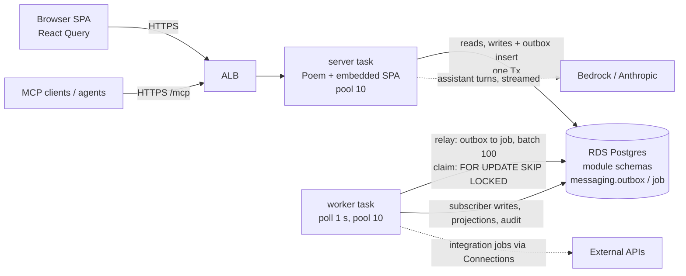

# Expected usage and AWS resource estimates

## Executive summary

**What it is.** An internal suite of 6 business apps for one company of about 100 staff. It is a modular-monolith Rust server with an embedded React SPA and a Postgres-backed event outbox (the "kafka-lite" mechanism). It is single-tenant, busy during working hours and near idle overnight.

**Expected load.** Peak-hour traffic is about 7 to 36 API requests a second, bursting to about 110 at the generous design peak, with about 20% of requests writing. Each write fans out to 3 to 5 background subscriber jobs, which come to about 54 a second at that peak, bursting to about 165. This fan-out, not the web traffic, is the main load on the database. Even at the generous peak, every component runs at 25% or less of its capacity.

**Resources (the same in every region):**

| Component | Size | Peak utilisation (generous case) |
|---|---|---|
| ECS Fargate `server` (API, SPA, MCP) | 1 task, 0.5 vCPU / 1 GB, ARM64 | ~25% CPU, under 10% memory |
| ECS Fargate `worker` (events, jobs) | 1 task, 0.25 vCPU / 0.5 GB, ARM64 | ~25% of one worker's throughput |
| RDS PostgreSQL 17 | db.t4g.medium (2 vCPU / 4 GiB), 50 GB gp3 | ~20% CPU in the peak hour |
| ALB + NAT gateway, logs, secrets | 1 each | — |
| Redis / Valkey | not needed yet | — |

**Monthly cost (USD, on-demand, 730 h):**

| | US (us-east-1) | EU (eu-west-1, Ireland) | AU (ap-southeast-2, Sydney) |
|---|---|---|---|
| Fargate `server` | $14 | $16 | $17 |
| Fargate `worker` | $7 | $8 | $9 |
| RDS db.t4g.medium, Single-AZ | $47 | $50 | $74 |
| gp3 storage 50 GB | $6 | $6 | $7 |
| ALB | $18 | $20 | $20 |
| NAT gateway (or public IPs + VPC endpoints) | $35 | $37 | $45 |
| CloudWatch, Secrets Manager, ECR | $10 | $10 | $10 |
| **Lean total** | **~$140** | **~$150** | **~$180** |
| **With HA** (2 servers, 2 workers, Multi-AZ RDS) | **~$220** | **~$235** | **~$295** |
| Later step-up to db.m7g.large (non-burstable), Single-AZ | +~$75 | +~$85 | +~$100 |

The Fargate ARM unit rates behind these figures: US $0.0324 per vCPU-hour and $0.0036 per GB-hour; Sydney $0.0389 and $0.0043; Ireland is estimated at about 20% below its x86 rate. RDS db.t4g.medium: about $47 a month in us-east-1, about $0.069 an hour in eu-west-1 and about $74 a month in Sydney. ALB, NAT and storage are approximate regional list prices. A 1-year Savings Plan or Reserved Instance takes about 20 to 35% off. Confirm the totals in the AWS Pricing Calculator.

**Recommendation.** Start lean on 1 server, 1 worker and a Single-AZ db.t4g.medium in the region closest to staff. Compute is under 20% of the bill, and the database and fixed network costs dominate. Move RDS to Multi-AZ when about 10 minutes of failover downtime becomes unacceptable. Scale the server out only after solving MCP session stickiness (7.3). Load-test staging before go-live (7.8).

---

For one company of about 100 people running 6 apps (Capabilities) on this template, deployed on ECS Fargate with RDS for PostgreSQL. Single-tenant: one environment, one database, one org. Prepared 2026-11-28 from the code at `main` plus a quick local benchmark.

**Short answer**

| Component | Start with | Grow to when |
|---|---|---|
| `server` (API, SPA, `/mcp`) | **1 task, 0.5 vCPU / 1 GB, ARM64** | 2+ tasks once MCP sessions don't need stickiness (see 7.3), or CPU > 60% |
| `worker` (outbox relay, subscribers, jobs, schedules) | **1 task, 0.25 vCPU / 0.5 GB, ARM64** | 2 tasks when job lag stays > 5 s at peak |
| `migrate` | one-off task per deploy, 0.25 vCPU / 0.5 GB | never |
| RDS PostgreSQL 17 | **db.t4g.medium (2 vCPU, 4 GiB), 50 GB gp3**, Single-AZ, PITR on | db.m7g.large when CPU credits trend down or CPU > 40% sustained, Multi-AZ when an outage of ~10 min costs more than about $75 a month |
| Valkey (ElastiCache) | **none**: no module broadcasts yet | the first module that calls `app_bus` |

At the generous design peak (about 110 API requests a second and 165 subscriber jobs a second), that comes to **about 0.75 vCPU and 1.5 GB of Fargate**, and the database runs at about 20% CPU during the peak hour. Cost is roughly **US$175 a month lean, about $290 with HA** in Sydney (section 8). The database and the fixed network costs dominate. Compute is almost nothing.

---

## 1. What the software is

- **Type.** Internal line-of-business software: a suite of apps (one App per Capability) in one SPA shell, used by staff during working hours. CRUD with optimistic concurrency, lists and searches, admin screens (access, connections, theme), an optional AI assistant, and every operation exposed as an MCP tool for agents.
- **Not multi-tenant.** One org, one rule set, about 100 principals. There are no noisy-neighbour or tenant-isolation costs, no per-tenant schemas, and the data set stays small (low GBs over years).
- **Load shape.** Read-heavy, bursty around 9 to 11 am and after lunch, near zero overnight. The traffic is human, not machine: requests per user are low, but each one fans out into several API calls.

## 2. Backend architecture as it affects sizing

The parts that matter for capacity:

| Fact (from the code) | Sizing consequence |
|---|---|
| One binary serves the API, the embedded SPA (1.2 MB JS bundle) and `/mcp` (ADR 0005). | One `server` service. Static assets are served from memory by the same tasks. |
| Modular monolith, one schema per module, one shared Postgres (ADR 0001, 0021). | One RDS instance. Modules don't add instances, only tables. |
| Each request: JWT verify (HS256 or cached JWKS), in-memory authorization (the rule set is rebuilt from the DB only when its revision moves, polled every 5 s, `access::POLL_EVERY`), then 1 to 3 SQL statements. | The server is cheap per request: about 0.35 ms CPU measured (section 4). There is no per-request authz query. |
| Every write saves one root and inserts one outbox row in the same transaction (ADR 0011, 0016). | One business write is about 2 to 4 row writes in the request path. |
| "Kafka-lite": the worker relays the outbox into `messaging.job` (one row per subscriber queue), then claims each job with `FOR UPDATE SKIP LOCKED`, runs the handler in its own transaction and deletes the job (ADR 0013, 0033). | Each write costs **1 + F** more transactions after the request, where F is the fan-out (the number of subscriptions on the topic). The Postgres work happens in the worker, not the request. |
| One relay at a time, by advisory lock, 100 events per batch (`RELAY_BATCH`). | Relay ceiling is in the thousands of events a second. Never the bottleneck here. |
| Each worker runs **one job at a time** (`while run_next()`), sequentially. | Worker throughput is about 1 / (job wall time), roughly 200 jobs a second per worker. Scale out by adding worker tasks. |
| The worker polls every 1 s when idle (`APP_WORKER_POLL_MS`). Delivery figures every 15 s. Compaction hourly. | A constant small DB load (about 1% of a core measured) and up to 1 s extra latency for the first event after an idle spell. |
| Outbox compaction keeps the latest event per key plus 7 days (topic retention). | The outbox stays small: MBs to low GBs. |
| `Idempotency-Key` on unsafe methods: a DB claim plus a record write. The SPA doesn't send one today; MCP tools can. | Applies only to agent writes. Negligible. |
| MCP sessions live in the memory of the process that opened them (ADR 0034). | **Several server tasks need stickiness by `Mcp-Session-Id`, which an ALB can't do** (section 7.3). |
| Assistant turns stream SSE from the server. Each tool call is an in-process call to `/api`. | Long-lived connections, very little CPU. The ALB idle timeout must be longer than a model call. |

Today's fan-out, from `messaging.subscription`: `users.user.v1` has 3 subscriptions, `notes.note.v1` 1, and each `access` topic 1 (the audit log). So F is 1 to 3 today. With 6 real apps, each owning a couple of roots whose topics feed their own search projection, the audit log, and a reaction or projection in one or two other apps, **F = 3 is realistic and F = 5 generous**.

## 3. Traffic model (Little's law)

Little's law for a closed system of users: **N = X · (R + Z)**, so **X = N / (R + Z)**. Here N is concurrent active users, X is throughput (interactions a second), R is response time and Z is think time between interactions. R (about 50 ms) is tiny next to Z, so X ≈ N / Z. Each interaction (a navigation, opening a dialog, saving a form) fans out into k API calls: React Query loads the page's list and its lookups, a mutation is followed by an invalidation refetch, and with the default `staleTime: 0` every window focus refetches the active queries.

| Input | Realistic (R) | Generous design (G) | Why |
|---|---|---|---|
| Headcount | 100 | 100 | given |
| Daily active users | 85 | 100 | almost everyone uses at least one of 6 apps |
| Active time in the apps per user per day | 3 h | 5 h | internal tools beside email, meetings and other systems |
| Peak concurrent active users, N | 50 (60% of DAU) | 100 (everyone at once) | the 9 to 11 am peak |
| Think time between interactions, Z | 20 s | 10 s | reading a list, filling a form |
| API calls per interaction, k | 2.5 | 3 | list + lookups + enrichment, or mutation + refetch |
| Background calls (focus refetch, permissions and theme at a 60 s stale time) | +20% | +20% | `refetchOnWindowFocus`, `use-my-permissions`, `theme-loader` |
| Share of API calls that write | 15% | 20% | typical for LOB software: 80 to 90% reads |
| Second-to-second burst over the peak-hour mean | ×3 | ×3 | people act in clumps |

### 3.1 API requests

Peak-hour mean: X_api = N · k / Z · 1.2

- R: 50 × 2.5 / 20 × 1.2 = **7.5 req/s**, bursting to **~23 req/s**
- G: 100 × 3 / 10 × 1.2 = **36 req/s**, bursting to **~110 req/s**

Daily volume: DAU × active seconds / Z × k × 1.2

- R: 85 × 10,800 / 20 × 2.5 × 1.2 ≈ **140k API requests a day** (~4.8 req/s over an 8 h day)
- G: 100 × 18,000 / 10 × 3 × 1.2 ≈ **650k API requests a day** (~22 req/s over an 8 h day)

Add about 10 full page loads per user a day (`index.html`, the 1.2 MB bundle, fonts), about 10k static requests a day, and agent and MCP traffic. Say 30 assistant users doing 20 turns a day with about 5 tool calls each: about 3k tool calls a day, which is also API requests. Both are noise next to the above.

**Concurrency inside the server** (Little's law again, L = λ·W): at the G burst, 110 req/s × ~15 ms on Fargate (DB round trips included) ≈ **1.7 requests in flight**. Connections held: 110 × ~4 ms ≈ **0.5 of the 10-connection pool**. Streaming assistant turns: λ ≈ 600 turns over 8 h ≈ 0.02/s, × ~30 s per turn ≈ **1 open stream** on average, 5 to 10 at a busy moment.

### 3.2 Writes, events and fan-out (the kafka-lite load)

events = writes × c, where c covers cascades: a subscriber's write publishes its own event, as a projection or reaction may. jobs = events × F, plus deferred jobs and Schedules, which are negligible.

| | R (F = 3, c = 1.2) | G (F = 5, c = 1.5) |
|---|---|---|
| Writes / day | 21k | 130k |
| Events / day | 25k | 195k |
| Subscriber jobs / day | 75k | ~1M |
| Writes / s, peak-hour mean (burst) | 1.1 (3.5) | 7.2 (22) |
| Events / s, peak-hour mean (burst) | 1.4 (4.2) | 11 (33) |
| **Jobs / s, peak-hour mean (burst)** | **4 (13)** | **54 (165)** |

Each business write costs Postgres roughly this:

- request: the root row (+ child rows) and 1 outbox insert, in 1 transaction
- relay: 1 outbox update and F job inserts, shared across a batch of up to 100
- each of F deliveries: claim (update), handler writes (1 to 3 rows), job delete, in 1 transaction each

So **about 3 + 3F row operations and 1 + F commits per write**: about 12 row ops and 4 commits at F = 3, about 18 and 6 at F = 5. **Fan-out, not the HTTP traffic, is what sizes the database** (section 4.3).

**Worker sizing by Little's law.** Measured locally, one worker drained 3,000 jobs in 11.5 s, about 260 jobs/s, as a debug build with Postgres on the same host. On Fargate to RDS, each job is about 6 round trips (claim, begin, handler, delete, commit) at about 0.5 to 0.8 ms each, so about 5 ms of wall time, or **~200 jobs/s per worker**. Utilisation ρ = λ × 5 ms:

- R: 4 jobs/s gives ρ ≈ 2%. Bursts of 13/s are 7%.
- G: 54 jobs/s gives ρ ≈ 27%. A burst of 165/s is 83%, but only for seconds: the outbox and job tables are the buffer, and a burst drains a few seconds behind. One worker suffices. A second gives redundancy and halves lag.

## 4. Measurements behind the per-unit costs

Measured on the dev stack with ApacheBench (`ab -c 10`): the release `server` binary on an Apple M5 Pro, Postgres 17 in Docker, the debug `worker`, and the seeded data set. These are **per-unit CPU costs** to scale from, not capacity claims. Graviton cores on Fargate and RDS are slower per core than an M5, so I apply a **×2 to ×3 factor** to every figure.

| Measure | Local, measured | Estimate on Fargate / RDS Graviton |
|---|---|---|
| Server CPU per list request (`GET /api/notes?limit=20`, JWT + authz + 2 queries + JSON) | 0.35 ms (10k requests, 3.53 s CPU) | **~1 ms** |
| Server CPU per write (`POST /api/notes`) | 0.40 ms (2k requests, 0.81 s CPU) | **~1.2 ms** |
| Throughput, one process, 10 concurrent | 3,100 list/s, 4,500 get/s, 2,300 create/s, p99 5 to 9 ms | not the limit at this scale |
| Postgres CPU per read | 0.24 to 0.6 ms | **~1 ms** |
| Postgres CPU per write (row + outbox) | 0.47 to 0.66 ms | **~1.3 ms** |
| Postgres CPU per delivered job (relay + claim + projection upsert + delete) | ~2.8 ms (with a 2,000-job backlog, so an upper bound) | **~5.5 ms** |
| Postgres CPU when idle (1 server + 1 worker polling) | ~12 ms/s (1.2% of a core) | ~50 ms/s for 2 servers + 2 workers |
| Server RSS (release) | 27 MB at start, 33 MB after 30k requests | ~40 to 60 MB |
| Worker RSS | ~25 MB | ~30 to 50 MB |
| Job drain, one worker | ~260 jobs/s (debug build, local DB) | **~200 jobs/s** (network RTT bound) |

The load-test rows were deleted from the dev database afterwards.

### 4.1 Server vCPU

- R burst: 23 req/s × 1 ms ≈ 0.02 vCPU
- G burst: 110 req/s × 1 ms ≈ **0.11 vCPU**

A 0.5 vCPU task serves about 400 req/s at 80% CPU, **nearly 4× the generous burst**. I'd still pick 0.5 rather than 0.25 vCPU: startup (JWKS discovery, compiling the rule set), the 5 s rule-set rebuild after a grant changes, and assistant turns all spike CPU briefly, and 0.25 vCPU CFS-throttles those spikes into visible latency. The extra cost is about $9 a month.

### 4.2 Server and worker memory

Measured RSS is under 60 MB, all in. In-memory state is tiny: the compiled rule set (100 principals), MCP sessions (5 min idle), assistant turns in flight. **1 GB per server task and 0.5 GB per worker** leaves more than 90% headroom. Memory is not a constraint for this app at this scale.

### 4.3 Database CPU

Postgres vCPU-seconds per second = reads × 1 ms + writes × 1.3 ms + jobs × 5.5 ms + idle 0.05

| | Reads | Writes | Jobs | Idle | Total | % of 2 vCPU |
|---|---|---|---|---|---|---|
| R peak-hour mean | 6.4/s → 0.006 | 1.1/s → 0.001 | 4/s → 0.022 | 0.05 | **0.08 vCPU** | 4% |
| G peak-hour mean | 29/s → 0.029 | 7.2/s → 0.009 | 54/s → 0.30 | 0.05 | **0.39 vCPU** | 19% |
| G burst (seconds) | 88/s → 0.09 | 22/s → 0.03 | 165/s → 0.91 | 0.05 | **~1.1 vCPU** | 54% |

In G, about 75% of the database's CPU goes to subscriber deliveries. A db.t4g.medium has a baseline of 20% per vCPU (0.4 vCPU sustained) and earns 24 CPU credits an hour, banking up to 576. So:

- **R** runs at a tenth of the baseline. The instance banks credits all day.
- **G** sits right at the baseline during the peak hour, bursts above it on credits, and falls to near idle outside work hours. It is fine for a working-hours profile. If G-level load ever ran for 8+ hours straight, Unlimited mode would start billing surplus credits (US$0.075 per vCPU-hour). That is the moment to move to **db.m7g.large**, which is non-burstable.

### 4.4 Database memory, storage, IOPS and connections

- **Data.** 6 apps × 100 users of business records: a few hundred MB in year one, low single-digit GB after a few years (more if apps store documents in Postgres, which they shouldn't: use S3). The outbox holds the latest event per key plus 7 days: ~0.3 GB (R) to ~2 GB (G) of churn at about 1.5 KB an event, since events carry the root's whole state. The access audit log grows forever but slowly. Jobs are deleted when they complete. Idempotency records live 24 h.
- **RAM.** With 4 GiB, `shared_buffers` (~1 GiB) holds the whole hot set for years. Move to 8 GiB (db.t4g.large or db.m7g.large) if the buffer cache hit ratio drops below ~99%.
- **Storage.** **50 GB gp3** (3,000 IOPS and 125 MB/s baseline included). G bursts are about 200 commits/s and about 400 row ops/s, well under the baseline IOPS. Turn on storage autoscaling with a 200 GB ceiling.
- **Connections.** Each process has a pool of 10 (`APP_DB_MAX_CONNECTIONS`): 1 to 2 servers + 1 to 2 workers + `migrate` gives at most 50, against the ~400 a db.t4g.medium defaults to. Little's law says fewer than 2 are busy at a time. No RDS Proxy needed.

## 5. Recommended Fargate topology (initial)

| ECS service / task | Count | Size (ARM64 / Graviton) | Notes |
|---|---|---|---|
| `server` | 1 | 0.5 vCPU / 1 GB | Rolling deploy with `minimumHealthyPercent=100`, `maximumPercent=200`, so a deploy never drops to zero. Health check `/health`. ECS replaces a failed task in about a minute. One task keeps MCP sessions working (7.3). |
| `worker` | 1 | 0.25 vCPU / 0.5 GB | Long-running poll mode. Its idempotent handlers and 5-minute lease make Fargate Spot safe (saves ~$5 a month). An interruption delays jobs in flight by up to the lease. On-demand is simpler. |
| `migrate` | one-off | 0.25 vCPU / 0.5 GB | Run as a pre-deploy task (`/usr/local/bin/migrate`) before the server and worker update. |
| ALB | 1 | — | HTTPS listener (ACM). **Idle timeout ≥ 300 s** for assistant SSE streams. Pass streams unbuffered. |
| RDS PostgreSQL 17 | 1 | db.t4g.medium, 50 GB gp3 | Single-AZ, 7-day PITR. Private subnets. Performance Insights (free tier) to check section 4's estimates. |
| Secrets | — | Secrets Manager / SSM | `DATABASE_URL`, `CONNECTIONS_MASTER_KEY`, model credentials. |
| Valkey | 0 | — | Not needed until a module broadcasts (ADR 0039). The server and worker refuse to start without it once one does. |

Everything is in 2 AZs, with private subnets for tasks and RDS. For egress (JWKS, Cognito, Bedrock or Anthropic, integration APIs), either one NAT gateway, or public subnets with public IPs plus VPC endpoints for ECR, Logs and Secrets Manager.

## 6. Scaling headroom and triggers

| Signal (CloudWatch / OTLP) | Threshold | Action |
|---|---|---|
| Server CPU | > 60% for 10 min | add a task, or 1 vCPU / 2 GB (sort out MCP first, 7.3) |
| Request p95 (`http.server.request.duration`) | > 300 ms | look at the DB first: slow queries, missing index |
| Job lag / dead letters (the worker's delivery figures) | lag > 5 s sustained at peak, or any dead letters | add a worker task / fix the handler |
| Pool waits (`app_web::PoolWaits`) | p95 > 10 ms | raise `APP_DB_MAX_CONNECTIONS` to 20 |
| RDS `CPUCreditBalance` | trending down day over day | db.m7g.large |
| RDS CPU | > 40% for an hour | db.m7g.large (later db.m7g.xlarge) |
| RDS buffer cache hit | < 99% | an 8 GiB class |
| RDS `FreeStorageSpace` | < 20% | storage autoscaling handles it |

**Headroom.** The recommended setup handles about 4× the generous burst on the server and about 1.2× on the worker per task (the outbox absorbs the rest as lag). The database is at about 20% of a burstable 2-vCPU at the G peak hour. A 500-person single-tenant deployment would still fit on 2 servers, 2 workers and one db.m7g.large.

## 7. Risks and cheap tuning found while reviewing

1. **The SPA's assets go out with no `Cache-Control`, no `ETag` and no compression** (`crates/server/src/app.rs`, `frontend::Spa`). Every full load downloads the 1.2 MB bundle again, uncompressed (~350 KB gzipped). It costs little money (~25 GB a month of egress, ~$3), but every cold load is slower. Fix: `Cache-Control: public, max-age=31536000, immutable` on `/assets/*` (the names are content-hashed), `no-cache` on `index.html`, and poem's `Compression` middleware. Or put CloudFront in front.
2. **React Query's default `staleTime: 0` with refetch on focus** is the biggest read multiplier. A global `staleTime` of 15 to 30 s would cut reads by about 30 to 50% with no visible staleness for LOB screens, since `If-Match` already protects writes.
3. **MCP sessions need stickiness by header, which an ALB can't do** (its stickiness is cookie-based, and MCP clients generally don't keep cookies). With 2+ server tasks behind round-robin, session requests land on the wrong task, get a `404`, and the client starts a new session again and again. Options: (a) **1 server task** (recommended initially, with ample capacity), (b) an ALB rule sending `/mcp*` to a separate single-task service from the same image, or (c) make `/mcp` stateless as Spec 0010 proposes. Decide this before scaling the server out.
4. **Worker jobs run one at a time per worker**, and a handler holds its transaction (and a connection) open while it runs (ADR 0011). An integration job calling a slow external API blocks that worker's other queues for the call's duration. If integrations become busy, give them their own worker deployment (the queues are named) or add workers.
5. **The claim query's cost grows with the number of subscriptions a worker serves**: it does a `LATERAL` index probe per (queue, event_type), plus the per-key ordering and backfill `NOT EXISTS` checks. That is fine at dozens of subscriptions. Watch it in Performance Insights as the apps grow to 50+ subscriptions.
6. **t4g credit trap.** Burstable RDS runs in Unlimited mode. If the load turns out to be sustained rather than working-hours bursty, surplus credits are billed. Watch `CPUSurplusCreditsCharged`.
7. **Assistant cost is tokens, not compute.** Each model call carries the tool list (one tool per operation: 49 today, more with 6 apps) and up to 50 history messages, so the tool schemas alone are many thousands of input tokens per call, with up to 10 tool calls a turn. Budget it separately (Bedrock or Anthropic), and consider prompt caching or a narrower tool set.
8. **Calibrate with a real load test.** These are model numbers scaled from a laptop. Before go-live, run a k6 scenario on staging (the same Fargate and RDS sizes) at the G mix: 110 req/s, 20% writes, F = 5. Confirm p95 < 200 ms, job lag < 5 s and RDS CPU < 50%.

## 8. Indicative monthly cost (ap-southeast-2, on-demand, USD)

Approximate list prices: Fargate ARM about $0.0389 per vCPU-hour and $0.0043 per GB-hour in Sydney. db.t4g.medium PostgreSQL in Sydney is about $74 a month Single-AZ. 730 h a month. Check the AWS Pricing Calculator before committing.

| Item | Lean start | With HA |
|---|---|---|
| `server` Fargate (0.5 vCPU / 1 GB) | 1 × ~$17 | 2 × ~$17 = $35 (once 7.3 is solved) |
| `worker` Fargate (0.25 vCPU / 0.5 GB) | ~$9 | 2 × ~$9 = $17 |
| RDS db.t4g.medium | ~$74 (Single-AZ) | ~$148 (Multi-AZ) |
| gp3 50 GB + backups within the free allowance | ~$7 | ~$14 |
| ALB (+ LCUs, negligible here) | ~$20 | ~$20 |
| NAT gateway, or public IPv4 + VPC endpoints | ~$35 to 45 | ~$35 to 45 |
| CloudWatch logs and metrics, Secrets Manager, ECR | ~$10 | ~$15 |
| **Total** | **~$175 to 185** | **~$285 to 295** |

A 1-year Compute Savings Plan (Fargate) and an RDS Reserved Instance cut about 20 to 30% off the larger lines. The jump to db.m7g.large adds about $90 to 100 a month Single-AZ.

## 9. Assumptions to revisit

- 6 apps of LOB-style CRUD, with no app doing heavy reporting or analytics in Postgres. A reporting app scanning big tables changes the RDS sizing more than everything above. Give it a read replica or its own projection.
- No bulk imports or integration syncs moving thousands of rows a minute. A nightly sync of 50k records fans out to 50k × F jobs: at 200 jobs/s per worker that is ~4 minutes for F = 3, which is fine overnight.
- Agents over MCP behave like a few extra humans, not loops of hundreds of calls a minute. If agents are automated, apply Little's law to them separately: N_agents × calls a minute.
- Browser-to-ALB latency (Sydney) is not counted in R. It doesn't change throughput, since R ≪ Z.
